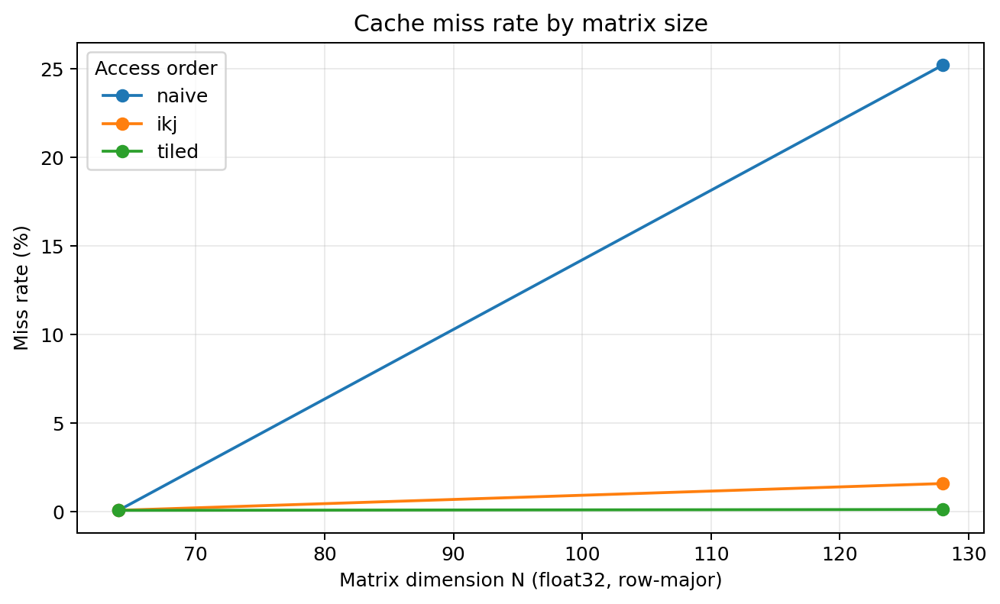
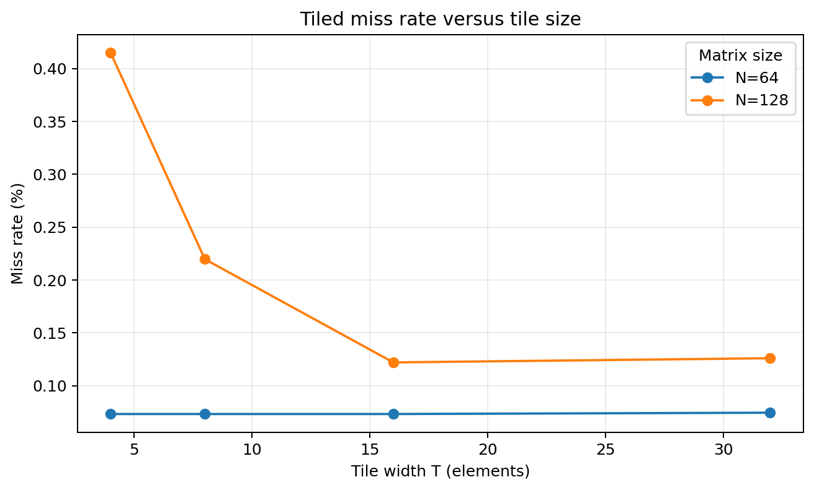
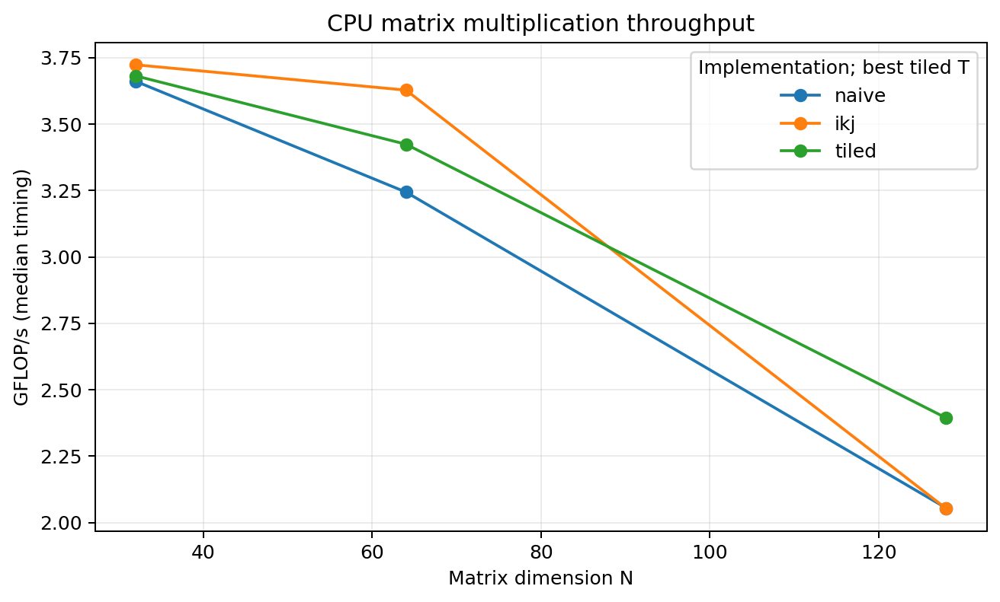

# Why Tiling Works: Cache Simulation and GPU Matrix Multiplication

`tilescope` is a reproducible teaching project that studies why blocked matrix multiplication reduces data movement. It combines a fast trace-driven C++17 cache simulator, a real-hardware C++ CPU benchmark, CUDA kernel source, experiment scripts, generated figures, and a detailed teaching report.

## Research question

Why is tiled matrix multiplication faster than the naive version?

The cache experiment compares naive `i-j-k`, reordered `i-k-j`, and a tiled `ii-kk-jj-i-k-j` address stream. The CPU program measures naive, `ikj`, and tiled float32 implementations. The CUDA program contains a naive global-memory kernel, shared-memory tiled kernels for widths 8, 16, and 32, and cuBLAS SGEMM as a reference.

## Measured findings from this run

All cache, CPU, and throughput numbers below are generated by the programs in this repository and saved under `results/`. Cache miss rates are for the explicit four-event stream: load A, load B, load C, and store C per multiply-accumulate. They are not hardware timing measurements.

- At N=512 in the 32 KiB, 64-byte, 8-way LRU model, naive `i-j-k` had 134,528,000 misses (25.058%) and tiled T=8 had 2,108,480 misses (0.393%) over 536,870,912 modeled accesses.
- The lowest-miss tile among the measured widths was T=16 at N=128 and N=256, and T=8 at N=512. The best tile depends on the matrix size and cache mapping.
- Padding the leading dimension from N=512 to N=520 reduced naive misses from 134,528,000 to 92,771,826, and tiled T=8 misses from 2,108,480 to 1,517,059 in the simulator.
- On this host, the 500-million-access simulator check completed in 15.066 seconds. This is one machine's measurement, not a speed guarantee for other systems.
- In the CPU benchmark at N=1024, naive reached 0.520 GFLOP/s, `ikj` reached 1.989 GFLOP/s, and the fastest measured tiled run (T=32) reached 2.109 GFLOP/s. The cache model and CPU timings are related evidence, but their access and execution models differ.







## Reproduce

Requirements: a C++17 compiler (`g++` is used by default), Python 3.10+, and the packages in `requirements.txt`. The Makefile delegates builds and experiment logic to Python, so its recipes work with GNU Make. On Windows with MinGW, use `mingw32-make` if `make` is not on PATH.

```bash
# Build and test
make build
make test

# Short pipeline: tests, reduced cache and CPU sweeps, figures, PDF
make quick

# Full tests and sweeps; CUDA is also run automatically when nvcc is available
make all
```

The full experiment run covers N = 64, 128, 256, and 512 for the main access-order and tile-size comparisons. It runs capacity, associativity, line-size, miss-classification, and N=512 versus N=520 padded-stride experiments. Associativity and line-size sensitivity use a fixed N=64 to keep the fully associative scan tractable. `make all` detects `nvcc` and runs the GPU path only when it is available. Full output CSVs are written to `results/`; all plots are saved as PNG and PDF under `figures/`.

To run individual steps:

```bash
python python/build.py --target build
python python/build.py --target test
python python/performance_check.py
python python/run_experiments.py          # add --quick for the short sweep
python python/run_cpu_bench.py            # add --quick for the short sweep
python python/plot_results.py
python python/build_report.py
```

The optional trace reader accepts one `R` or `W` operation and one decimal or hexadecimal byte address per line. See [docs/TRACE_FORMAT.md](docs/TRACE_FORMAT.md). Run `build/cache_sim --help` for simulator options.

## GPU run

This environment had no `nvcc` command, so `results/gpu_results.csv` is intentionally absent and the GPU chapter of the PDF says **RESULTS PENDING - run on a GPU**. No GPU timings or profiler metrics are fabricated.

On a CUDA Toolkit host with cuBLAS, run:

```bash
make gpu
```

Or open [notebooks/run_gpu_on_colab.ipynb](notebooks/run_gpu_on_colab.ipynb), enter the clone URL for your Git repository in its first cell, and run it with a Colab GPU runtime. (This workspace has no configured Git remote, so the notebook asks for the project's URL instead of inventing one.) The driver checks every CUDA API call, compares the naive and tiled results against cuBLAS using absolute tolerance 0.01 and relative tolerance 0.001, warms up, uses CUDA events, reports median timing, and writes the GPU name plus CUDA runtime and driver versions to `results/gpu_results.csv`. After adding that CSV locally, run `make figures report` to rebuild the GPU plot and report.

If Nsight Compute is installed, `python/profile_ncu.sh` requests the basic metric set for the naive and tiled kernels at N=512. Metric availability varies by device and tool version; only real profiler output should be reported.

## Project layout

```text
src/cache_sim/       C++17 cache core and CLI
src/cpu_bench/       Correctness-checked CPU matmul benchmark
src/cuda/            Naive and shared-memory CUDA kernels and driver
python/               Build, validation, experiment, plotting, and PDF scripts
tests/                C++ unit tests and randomized Python-reference cross-check
results/              CSV and metadata from actual runs
figures/               Generated PNG and PDF diagrams and plots
report/                Report source note and generated PDF
notebooks/             Colab GPU-run notebook
docs/                  Trace format notes
```

## What the simulator models

The cache is single-level and set-associative. Capacity, line size, associativity, LRU/FIFO replacement, loads/stores, write-back, write-allocate, evictions, dirty write-backs, and optional compulsory/capacity/conflict classification are modeled. Matrix addresses are generated on demand; large traces are not materialized. The hot path stores lines in flat arrays and performs no per-access heap allocation.

The model does not include a multi-level cache, coherence, hardware prefetching, TLBs, out-of-order execution, or multiple concurrent cores. The CPU timing does include the effects of the local compiler and processor, but it is only one run environment. The hand-written CUDA kernels are teaching examples and are not intended to compete with cuBLAS.

## Report

The report is built with `make report` using ReportLab. Its prose and generation code are in [python/build_report.py](python/build_report.py); its source note is [report/report_source.md](report/report_source.md). Every experiment plot is generated from CSV results, and the GPU chapter detects whether `results/gpu_results.csv` exists.
